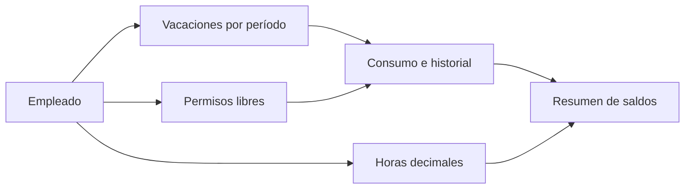

# Gestión de Vacaciones

**Autor y responsable del proyecto: Ronnie Benítez**  
[Perfil de GitHub](https://github.com/Ronniefbs)

Aplicación de escritorio para organizar empleados, vacaciones pendientes de distintos períodos, permisos libres y horas trabajadas. El desarrollo comenzó en octubre de 2026 y continúa en fase de mejoras.

## Cómo funciona
1. Seleccionar al empleado y consultar sus saldos.
2. Revisar las vacaciones pendientes de cada período.
3. Registrar el consumo con fecha y motivo. Se utiliza primero el período más antiguo.
4. Consultar el historial. Una anulación devuelve días y conserva el movimiento original.
5. Revisar las horas decimales en un saldo separado de las vacaciones.

## Funciones disponibles
- Consulta y gestión de empleados.
- Saldos por período y permisos libres separados.
- Historial de consumos y anulaciones.
- Validación de saldo suficiente y guardado transaccional.
- Tablas y ventanas que se adaptan al tamaño de pantalla.

## En desarrollo
- Nuevos períodos por aniversario.
- Solicitudes con calendario y reincorporación.
- Documento de vacaciones en PDF, vinculado al historial.
- Asignación de permisos a todos los empleados o por área.

## Generación del documento de vacaciones

**Función planificada, pendiente de implementación y de aprobación del formato por Recursos Humanos.**

Desde la aplicación se seleccionará al empleado y el período de vacaciones mediante un calendario. Antes de confirmar, se mostrarán:

- Fecha de inicio y último día de vacaciones.
- Fecha de reincorporación al trabajo.
- Cantidad de días solicitados y saldo disponible antes y después del descuento.
- Períodos de los que se tomarán los días, comenzando por el más antiguo.

El documento se generará en PDF utilizando la **plantilla establecida y aprobada por el área de Recursos Humanos**, con los datos, numeración y espacios de firma que esa área determine. El conteo de días y la reincorporación se configurarán conforme a las reglas aplicables y al horario del empleado.

El flujo previsto será:

1. Seleccionar empleado y fechas.
2. Revisar los días, saldos y vista previa del documento.
3. Aprobar la solicitud según los permisos del usuario.
4. Registrar el descuento y guardar el PDF asociado a la solicitud.
5. Abrir el documento desde un botón en el historial para consultarlo, imprimirlo o exportarlo.

Se conservarán las versiones emitidas y los datos utilizados en cada documento. Las anulaciones deberán devolver los días correspondientes sin borrar el historial.

Esta descripción presenta el alcance del desarrollo. No publica el formato interno de Recursos Humanos ni documentos de trabajadores. La plantilla definitiva y su contenido todavía deben validarse antes de implementar la generación.

## Tecnología
Python, PyQt6 y SQLite.

## Presentación y código
Este repositorio contiene la presentación pública del proyecto. El código se mantiene en un repositorio privado. No se publican bases de datos, documentos de empleados, credenciales ni información de la empresa. Las capturas del sistema se incorporarán únicamente después de su anonimización.
