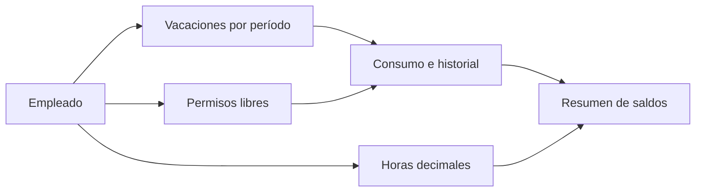

# Gestión de Vacaciones

**Autor y responsable del proyecto: Ronnie Benítez**  
[Perfil de GitHub](https://github.com/Ronniefbs)

Aplicación de escritorio para organizar empleados, vacaciones pendientes de distintos períodos, permisos libres y horas trabajadas. El desarrollo comenzó en octubre de 2026 y continúa en fase de mejoras.

## Cómo funciona
1. Seleccionar al empleado y consultar sus saldos.
2. Revisar las vacaciones pendientes de cada período.
3. Registrar el consumo con fecha y motivo. Se utiliza primero el período más antiguo.
4. Consultar el historial. Una anulación devuelve días y conserva el movimiento original.
5. Revisar las horas decimales en un saldo separado de las vacaciones.

## Funciones disponibles
- Consulta y gestión de empleados.
- Saldos por período y permisos libres separados.
- Historial de consumos y anulaciones.
- Validación de saldo suficiente y guardado transaccional.
- Tablas y ventanas que se adaptan al tamaño de pantalla.

## En desarrollo
- Nuevos períodos por aniversario.
- Solicitudes con calendario y reincorporación.
- Documento de vacaciones en PDF, vinculado al historial.
- Asignación de permisos a todos los empleados o por área.

## Tecnología
Python, PyQt6 y SQLite.

## Presentación y código
Este repositorio contiene la presentación pública del proyecto. El código se mantiene en un repositorio privado. No se publican bases de datos, documentos de empleados, credenciales ni información de la empresa. Las capturas del sistema se incorporarán únicamente después de su anonimización.
